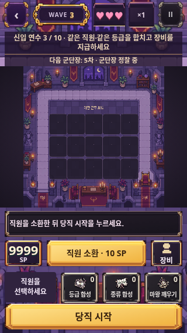
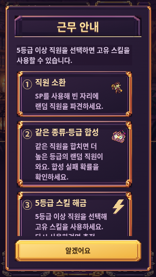
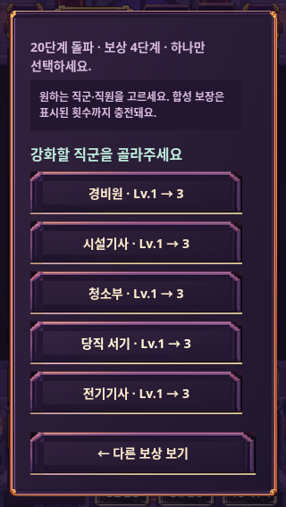

# 화면 표시 오류 수정 내역

[수정 전 검토 V01~V10](visible-ui-issues.md)의 항목을 반영했다. 배포 캐시 키는 `visible-ui-1`이다.

| 항목 | 반영 내용 |
| --- | --- |
| V01 SP 충돌 | 숫자·단위의 마크업과 높이를 분리했다. SP 패널의 레이아웃을 밀어내던 텍스트 번개를 제거하고 9999까지 프레임 안에 들어가도록 정렬했다. |
| V02 글자 중첩 | 전투 시작 및 주요 금색 버튼의 어두운 글자 그림자를 제거했다. |
| V03 안내 생략 | 연수 안내의 고정 한 줄 높이·말줄임을 해제하고 단어 단위로 줄바꿈한다. 긴 안내는 필요한 높이를 확보한다. |
| V04 도움말 제목 | 제목·닫기 버튼을 고정하고 본문만 스크롤하게 했다. 첫 진입 때 닫기 버튼 자동 포커스로 제목이 밀려나던 상황을 방지한다. 도입 설명은 14px로 유지한다. |
| V05 보상 돌아가기 | ‘다른 보상 보기’를 스크롤 목록 밖의 고정 하단 행동으로 옮겼다. 직원·장비 선택이 길어져도 돌아갈 수 있다. |
| V06 가격 정렬 | 가격·코인 단위를 한 줄로 묶고 수량·부족 사유와 함께 가운데 정렬했다. |
| V07 도감 경계 | 푸터 구분선, 목록 끝 여백과 스크롤 여백을 추가했다. 마지막 카드가 푸터 위까지 온전히 올라오는지 확인했다. |
| V08 훈련 경계 | 결제 푸터 구분선과 본문 하단 여백을 추가했다. 마지막 직원 카드가 결제 영역에 가려지지 않는지 확인했다. |
| V09 비활성 스킬 | 안내 영역에 불투명 배경과 밝은 글자를 적용해 배경 삽화와 분리했다. |
| V10 로비 보조 문구 | 편성 요약의 글자를 12px로 고정하고, 보상 안내의 줄 높이·배경·하단 위치를 정리했다. |

게임의 보상 수치·배속·저장 정책과 발열 완화 기능은 유지한다. Android의 viewport 단위 폴백도 그대로 사용한다.

## 검증

- 전체 46개 테스트 통과. 마지막 스타일 조정 후 화면 경계 전용 4개 테스트를 추가로 통과했다.
- 신규 검증: 네 자리 SP와 단위의 패널 내부 배치, 긴 연수 안내의 넘침 여부, 도움말 스크롤 중 제목·닫기 위치 유지, 보상 하위 선택의 돌아가기·마지막 선택 접근, 도감·훈련의 마지막 카드와 푸터 경계.
- 320×568, 390×844, 1280×900에서 기본 7화면과 긴 안내·보상 목록 상하단을 합쳐 30장 재캡처했다. 주요 변경 화면을 원본으로 확인했다.
- Android 실기기 테스트 결과는 아니다. 기존 Android 터치 에뮬레이션 및 구형 기능 제한 회귀 테스트를 포함한다.

## 수정 후 대표 화면

### 작은 화면의 긴 안내와 네 자리 SP

### 도움말 제목·닫기 고정

### 보상 목록 최하단과 돌아가기

### 상점 구매 정보 정렬

### 로비 보조 정보

