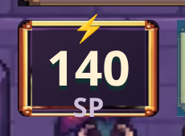
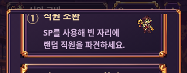
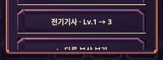
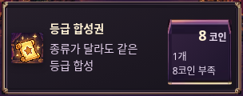
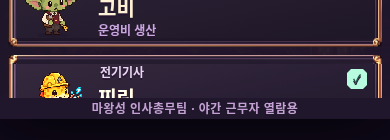
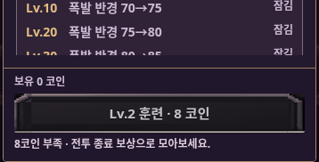
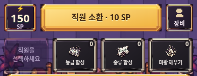

# 캡처 기준 화면 표시 오류 정리

> 수정 전 검토 기록입니다. 후속 적용 내용은 [화면 오류 수정 내역](visible-ui-fixes.md)을 참고하세요.

발열 개선 이후 기본 화면 캡처 21장(320×568, 390×844, 1280×900 각각 로비·전투·훈련·도감·상점·도움말·결과), 공개 사이트 Android 에뮬레이션 전투 1장, 반값 소환 안내 4장, 보상 선택 6장 등 **32장을 직접 확인**했다. 기존 사용성 리뷰 U01~U20과 그 반영 문서도 대조했다.

이 문서는 **캡처에서 보이는 증상**을 기록한다. 기본 화면은 `heat-1` 시점, 보상·튜토리얼은 각각 해당 기능 추가 시점의 캡처다. Android 전투는 호환성 수정 배포 뒤 캡처다. 따라서 모든 항목이 최신 코드에서도 재현된다고 확정한 목록은 아니다. 이번 작업에서는 게임 코드를 수정하지 않았다.

## 오류 종류와 우선순위

| 종류 | 관찰 내용 | 해당 항목 | 우선순위 |
| --- | --- | --- | --- |
| 텍스트와 프레임 충돌 | SP 단위가 재화 패널 하단 선에 걸림 | V01 | P1 |
| 글자 겹침처럼 보이는 렌더링 | 주요 버튼의 어두운 그림자가 글자 아래에 겹쳐 보임 | V02 | P1 |
| 필수 문구 생략·잘림 | 연수 안내 말줄임, 짧은 도움말에서 제목 미노출 | V03, V04 | P1 |
| 조작 버튼 일부 잘림 | 작은 화면의 보상 하위 선택에서 돌아가기 버튼 일부만 표시 | V05 | P1·동작 재확인 |
| 정보 정렬·배치 불균형 | 상품 구매 버튼 안에서 가격·수량·부족 사유의 축이 다름 | V06 | P2 |
| 목록 경계의 시각적 잘림 | 도감 카드·훈련 행이 스크롤 경계에서 잘려 보임 | V07, V08 | P2·스크롤 경계 개선 |
| 상태·보조 정보 가독성 부족 | 비활성 스킬 안내와 로비 보조 문구가 작거나 배경에 묻힘 | V09, V10 | P2 |

P1은 정보 읽기·다음 행동 판단에 직접 영향을 주는 항목, P2는 읽기와 시각적 완성도 개선 항목이다. 캡처만으로 진행 불가가 확인된 P0는 없다. 서로 다른 텍스트 요소끼리 실제로 포개졌다는 증거와 그림자 때문에 겹쳐 보이는 현상은 구분한다.

## P1 · 우선 정리

### V01. SP 단위와 하단 프레임 충돌

- **위치:** 전투 하단 왼쪽 재화 패널. `390-battle.png`, `320-battle.png`, `live-android-battle.png`.
- **보이는 증상:** 숫자는 한 줄이지만 아래의 `SP`가 프레임 하단에 걸리거나 밖으로 내려온다. Android 고배율 캡처에서 특히 명확하다.
- **영향:** 숫자·단위·테두리가 붙어 재화 패널이 깨져 보인다.
- **완료 기준:** 숫자와 단위를 각각 확보한 영역 안에 배치한다. 0/99/100/9999를 넣어도 두 텍스트가 테두리와 만나지 않아야 한다. 번개 장식이 프레임 밖으로 나오는 것과는 별개다.

### V02. ‘당직 시작’ 글자가 이중으로 겹쳐 보임

- **위치:** 전투 준비 화면 하단의 금색 `당직 시작` 버튼. Android 전투 캡처와 390·1280 전투 캡처.
- **보이는 증상:** 어두운 글자 아래쪽에 같은 글자 형태가 내려앉아 획이 뭉친다. 로비의 같은 이름 버튼보다 무겁고 읽기 어렵다.
- **판정:** DOM에 문구가 두 번 들어갔다는 뜻은 아니다. 캡처상의 그림자·글자 중첩 현상이다.
- **완료 기준:** 밝은 버튼의 어두운 글자는 그림자를 제거하거나 옅게 조정하고, 로비·전투의 같은 주요 행동에 동일한 글자 규격을 적용한다.

### V03. 연수 안내의 핵심 문장이 말줄임으로 끊김

- **위치:** `320-03-summon.png` 상단 연수 안내.
- **보이는 증상:** `같은 직원·같은 등급을 합치고 장비를 지급하...`로 끝나 행동 설명이 완결되지 않는다.
- **영향:** 처음 배우는 사용자가 무엇을 해야 하는지 문장 전체로 확인하기 어렵다.
- **완료 기준:** 짧은 화면용 완결 문장으로 줄이거나 2줄을 확보한다. 전체 안내를 여는 동작이 있더라도 화면에 보이는 핵심 행동은 끝까지 읽혀야 한다.

### V04. 320×568 도움말에서 제목·도입 설명이 보이지 않음

- **위치:** `320-help.png`의 화면 상단.
- **보이는 증상:** 390px·데스크톱에는 있는 `근무 안내` 제목과 도입 문장 없이 첫 번째 설명 카드부터 시작한다. 상단 여백도 매우 좁다.
- **판정:** 캡처에서 제목이 보이지 않는 것은 확인했다. 초기 배치 문제인지, 캡처 시점의 스크롤 위치인지는 다시 열어 확인해야 한다.
- **완료 기준:** 도움말을 처음 열었을 때 제목과 시작 내용을 확인할 수 있어야 한다. 짧은 화면에서도 제목 또는 고정 헤더와 본문 스크롤을 구분한다.

### V05. 보상 하위 선택의 ‘다른 보상 보기’ 버튼이 일부만 보임

- **위치:** `320-equipment-choice.png`, `320-staff-choice.png` 하단.
- **보이는 증상:** 직원·직군 선택지는 보이지만, 마지막 `← 다른 보상 보기` 버튼의 아래쪽과 문구 일부가 화면 하단에서 잘린다. 360px 장비 선택에서는 온전히 보인다.
- **영향:** 현재 선택에서 되돌아갈 수 있다는 사실이 작은 화면에서 약해진다.
- **판정:** 스크롤로 접근할 수 없는 상태라고 단정하지 않는다. 목록 길이와 스크롤 위치에 따른 버튼 노출을 동작으로 재확인할 항목이다.
- **완료 기준:** 돌아가기 행동은 고정 하단에 두거나, 스크롤이 필요하다는 단서를 제공한다. 최하단까지 스크롤했을 때 버튼과 문구 전체가 보여야 한다.

## P2 · 시각 규격과 가독성

### V06. 구매 버튼의 가격·수량·부족 사유 정렬 불균형

- **위치:** 320·390 상점의 소모 아이템 구매 버튼.
- **보이는 증상:** `8 코인`은 오른쪽 위, `1개`와 `8코인 부족`은 왼쪽 아래로 나뉘어 같은 버튼의 정보가 다른 축에 놓인다. 320px에서 텍스트와 장식 프레임 사이 여백도 좁다.
- **완료 기준:** 버튼 안의 가격과 수량 정렬 축을 통일한다. 부족 사유는 별도 보조 행으로 구분하고 긴 사유도 프레임 안에서 완결되게 한다. 현재 캡처에서 가격 숫자 자체가 겹쳤다고 판정한 것은 아니다.

### V07. 도감 목록 카드가 하단 푸터 경계에서 갑자기 끊겨 보임

- **위치:** `390-roster.png`의 다섯 번째 카드, `320-roster.png`의 목록 하단.
- **보이는 증상:** 카드 프레임·초상·이름이 푸터 경계에서 부분 노출된다. 마지막 항목인지 더 내려갈 수 있는지 정지 화면만으로는 약하다.
- **판정:** 스크롤 목록의 부분 노출 자체는 정상일 수 있다. 이 항목은 카드 데이터가 사라지는 버그가 아니라 목록 경계의 시각적 안내 문제다.
- **완료 기준:** 본문과 푸터 경계를 명확히 구분하고 스크롤 단서를 준다. 마지막 카드까지 내렸을 때 이름·역할·프레임 전체를 확인할 수 있는 하단 여백을 확보한다.

### V08. 훈련 효과 행이 결제 푸터 바로 위에서 잘려 보임

- **위치:** `390-training.png`의 두 번째 직원 효과 카드 하단.
- **보이는 증상:** 효과 문구의 아래쪽이 본문 스크롤 경계에서 끊기고 바로 아래에 보유 코인·훈련 버튼이 이어진다.
- **판정:** V07과 마찬가지로 스크롤 경계 현상이다. 결제 영역이 본문을 잘못 덮고 있는지, 정상적인 본문 클리핑인지는 동작 확인 전에는 확정하지 않는다.
- **완료 기준:** 본문 끝과 결제 영역 사이 구분·여백을 확보하고, 마지막 효과 행까지 스크롤해 온전하게 읽을 수 있어야 한다.

### V09. 비활성 스킬의 안내 문구가 배경에 묻힘

- **위치:** 전투 하단 왼쪽 `직원을 선택하세요` 영역.
- **보이는 증상:** 다른 아이템 버튼보다 배경이 투명하고 글자가 흐려 뒤쪽 삽화와 섞인다. 두 줄 안내가 좁은 영역에 들어간다.
- **영향:** 사용 불가 상태와 다음에 해야 할 행동을 함께 알아보기 어렵다.
- **완료 기준:** 비활성 배경과 안내 글자의 대비를 분리한다. 버튼을 흐리게 하더라도 `직원 선택 필요` 같은 사유는 읽히게 한다. 대비율은 캡처 인상만으로 수치 판정하지 않고 수정 때 실제 측정한다.

### V10. 로비 보조 문구가 주요 버튼·장식 대비 지나치게 작음

- **위치:** `320-lobby.png`의 `근무 5/5 · 편성 / 공격 3 · 지원 2`, 시작 버튼 아래 보상 안내, 하단 메뉴 레이블.
- **보이는 증상:** 큰 금색 프레임·시작 버튼에 비해 보조 글자가 촘촘하고 작다. 보상 안내는 버튼과 하단 내비게이션 사이에 바짝 끼어 있다.
- **판정:** 텍스트 겹침이 확인된 항목은 아니며 가독성과 간격 문제다.
- **완료 기준:** 보조 글자는 최종 표시 크기 12px 이상을 시작 목표로 검토하고, 보상 안내 위아래에 독립된 여백을 준다. 이 수치는 캡처의 실측값이 아니라 수정 목표다.

## 기존 리뷰와의 관계

- 이전 U02의 **SP 숫자 자체가 두 줄로 갈라지는 문제**는 이번 기본 전투 캡처에서 관찰되지 않았다. V01은 숫자 줄바꿈이 아니라 **단위와 프레임의 충돌**이다.
- 기존 U01 채용 결과 팝업 문제는 이번 기본 화면 세트에 해당 상태가 없으므로 재발 여부를 판정하지 않는다. 기존 수정 완료 기록을 그대로 존중한다.
- U05 도감 카드 수, U07 훈련 구조 개선 이후에도 V07·V08처럼 스크롤 경계의 표현은 따로 다듬을 수 있다. 부분 카드가 보인다는 이유만으로 기존 수정을 실패로 판정하지 않는다.
- 화면 주변의 검은 여백과 데스크톱의 중앙 세로형 게임 영역은 이번 오류 목록에 포함하지 않는다.

## 수정 후 다시 확인할 범위

1. V01·V02: 320/360/390px, Android 기기 배율, SP 네 자리와 반값 상태.
2. V03·V04: 도움말을 새로 연 초기 위치, 가장 긴 연수 안내, 짧은 화면.
3. V05: 장비·직원 선택 진입 및 최하단 스크롤, 돌아가기 버튼 전체 노출.
4. V06~V10: 상점 긴 부족 사유, 도감·훈련의 마지막 항목, 비활성 상태, 로비 보조 글자.

정지 캡처로 판정하지 않은 항목: 실제 터치 영역, 스크롤로 복구되는지, 포커스 이동, 동적 텍스트 전환 시 충돌, Android 실기기의 재현 여부. 수정 시 별도 조작 검증이 필요하다.
