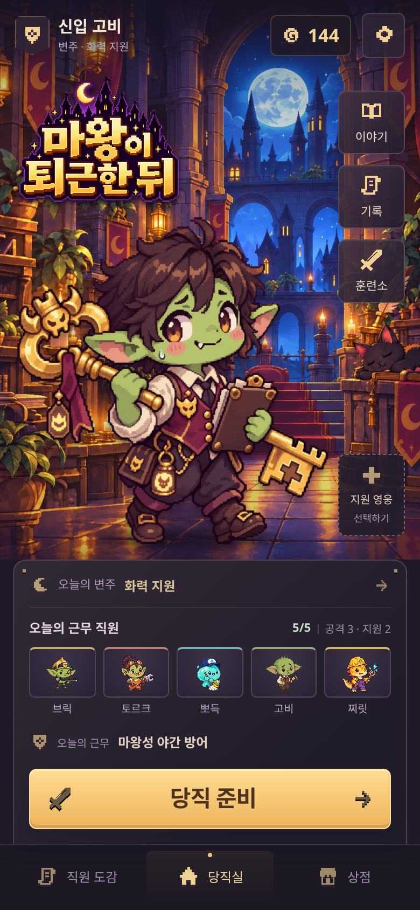

# 로비 개선 시안 · HTML 프로토타입

운영 코드와 분리된 시각 검토용 화면이다. 게임 진입 화면과 분리된 `/previews/lobby-direction/` 주소로 공개한다. 기존 애셋, 시스템 글꼴, CSS grid/flex, 실제 HTML 텍스트로 렌더링했다. 새 그림이나 생성된 UI 이미지를 전제로 하지 않는다.

## 바로 보기

- [브라우저에서 시안 열기](https://a01094864335-cell.github.io/after-hours-defense-play/previews/lobby-direction/)
- [대표 시안 PNG · 390×844, 2배 해상도](lobby-390.png)
- [HTML](index.html) · [CSS](lobby.css) · [화면 검사 결과](checks.json)

## 방향

- 작은 로고와 약 300px 고비로 장면의 주인공을 명확히 한다.
- 보조 버튼은 얇은 테두리·낮은 채도·작은 모서리로 정리하고 주요 행동에 호박색을 집중한다.
- 근무 명단은 한 줄 제목/편성 수 + 동일 크기 초상 5개. 역할 색은 초상 윗선에만 쓴다.
- 하단 GNB는 테두리를 줄이고 선택한 당직실만 빛·점으로 구분한다.
- 세계관 표현은 근무표 모서리의 작은 핀, 낮은 광택, 픽셀 아이콘으로 제한한다.

기존 로비의 기능 항목(설정, 코인, 이야기, 기록, 훈련소, 지원 선택, 일일 변주, 직원 편성, 근무 모드, 당직 준비, GNB 3개)을 유지했다. 수치는 예시이며 버튼의 실제 게임 이벤트는 연결하지 않은 검토용 화면이다. 적용할 때 기존 이벤트/노드를 옮길 수 있는 구조다.

## 확인

390×844를 대표 시안으로 사용한다. 320×568, 375×667, 390×568, 430×932도 캡처한다. 로고·캐릭터·바로가기·지원 선택·HUD 영역의 교차, 버튼 넘침, 화면 이탈, 이미지 로딩을 검사한다. 작은 화면에서는 지원 선택을 로고 아래 독립 영역으로 옮긴다.

로컬 서버에서 `/previews/lobby-direction/`을 열거나 `node previews/lobby-direction/capture.cjs`로 재현한다. 게임의 기능이나 진입 화면은 변경하지 않는다.
