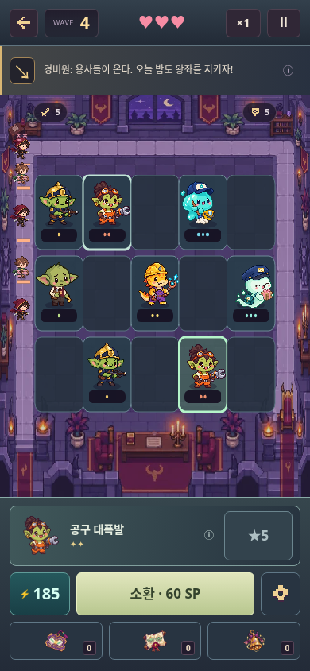
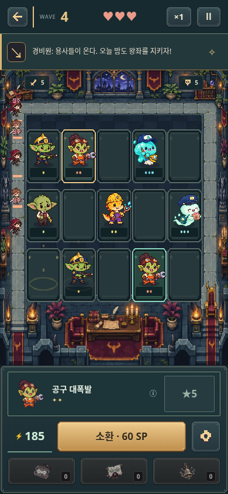
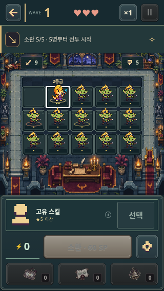
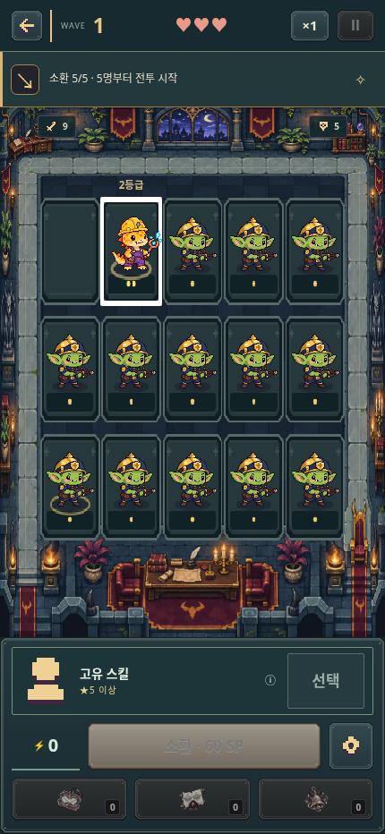

# 야간 경계 UI 검수

기준: `be365f0455843f578c6745c8cefcee4c3184951c`의 승인된 D 전투 레이아웃. 최신 상점과 보드 투영은 보존하고 전장·슬롯·버튼 재질과 소환/합성 효과를 교체했다.

비교 이미지는 같은 직원 배치·선택·자원·웨이브를 주입한 브라우저 검토용 상태다. 실제 플레이 화면의 Canvas와 컨트롤을 캡처했으며, 캐릭터나 문구를 이미지 위에 합성하지 않았다.

| 변경 전 | 변경 후 |
| --- | --- |
|  |  |

`checks.json`은 320×568, 360×640, 375×667, 390×740, 390×844, 430×932에서 15칸 터치 선택, 실제 버튼/포인터 합성, 조작부 화면 내 배치와 텍스트 넘침, 모션 감소 설정을 확인한 결과다. 합성 성공 검수에서는 난수만 고정했으며 실제 게임의 확률은 변경하지 않았다.

- Node 회귀 테스트: 71개 통과.
- 배포 패키징: 전용 전장·SVG 6종·로더를 포함. 배경 WebP 250,496 bytes.
- 배포 산출물 브라우저 smoke 11개 · 성능 회귀 8개 통과.

