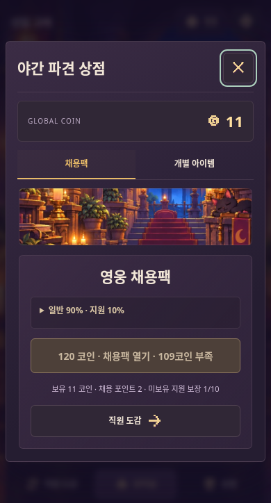
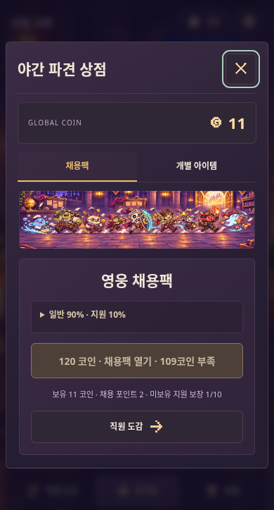

# 실제 채용팩 화면의 대소동 배너

기준: `after-hours-defense-play` main `f755d92dc8185ceb41c0aa578dfc4165ff4db626`. 실제 공개 게임 주소는 https://a01094864335-cell.github.io/after-hours-defense-play/ 이다. 구 저장소 `after-hours-defense`와 이전에 제안한 용병 정가 고용 화면은 이번 작업의 기준이 아니다.

## 변경

- 실제 적용 스타일 `ui.css`의 `.ref-market-scene` 배경만 교체했다.
- 높이 82px, 반경·테두리·탭·상품 UI·레이아웃은 유지한다.
- 가격 120코인, 일반 90% / 지원 10%, 채용 포인트, 미보유 지원 보장, 직원 도감과 구매·채용 결과 로직은 변경하지 않았다.
- 빌드 스크립트에 새 WebP를 포함해 배포 산출물에서도 같은 배너가 표시된다.
- 새 캐릭터 판매·새 희귀도·확정 고용 등의 기능은 추가하지 않았다.

`assets/ui-approved/shop-rush.webp`는 마왕성 채용소에서 캐릭터들이 우르르 달려오는 장식용 단체 애셋이다. 기존 캐릭터 단체 그림을 참조해 생성했으며 글자나 UI를 포함하지 않는다. 가로로 배치한 캐릭터와 금화·서류·소포·마법 효과로 대소동 분위기만 더했다. 생성 원본은 `/workspace/generated_images/exec-240e3097-681e-4823-86b0-bed0d31e503d.png`에 보존한다.

## 실제 캡처

`before.png`와 `after.png`는 실제 배포 빌드의 동일 화면이다. 비교를 위해 격리된 로컬 브라우저에 11코인·채용 포인트 2·지원 보장 1/10의 테스트 저장값을 넣었다. 사용자의 실제 저장은 접근하거나 수정하지 않았다. 새 UI를 이미지로 합성한 시안이 아니다.

## 검증

- `node --test tests/*.test.cjs`: 69개 통과.
- `node scripts/build-pages.cjs /tmp/after-hours-shop-rush-pages`: 623개 파일 빌드 성공, 신규 배너 포함.
- `UI_GAME_ROOT=/tmp/after-hours-shop-rush-pages python3 -m unittest discover -s tests -p test_browser_smoke.py -v`: 11개 통과.
- 실제 Chromium에서 변경 전후의 버튼·문구·가격과 화면 좌표가 동일함을 비교했다. 채용팩 구매 시 120코인 차감과 결과창 표시를 확인했다.
- 320×568, 375×667, 390×724, 390×844, 430×932의 두 상점 탭을 확인했다. 가로 넘침과 JavaScript·애셋 로드 오류 없음. 세부 결과는 `validation.json`에 기록한다.
- 현재 로컬 변경이며 공개 사이트에는 배포하지 않았다.
