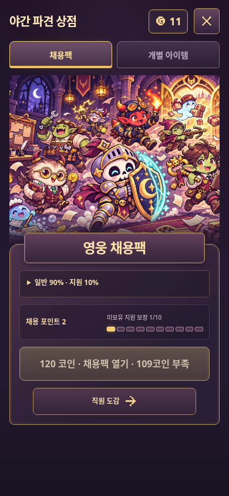
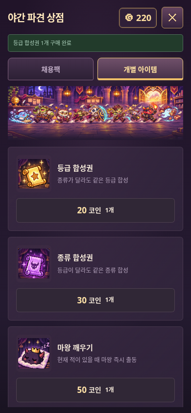

# A안 실제 게임 검토

`node scripts/check-shop-stage.cjs`로 재현한다. `UI_BASE_URL`과 `UI_CHROMIUM_PATH`로 대상 서버와 브라우저를 바꿀 수 있다. `*-pack.png`는 코인 부족 상태, `*-items.png`는 구매 후 아이템 탭이다. `checks.json`은 실제 채용팩 구매·지원 보장·도감 이동까지 확인한 결과다.

